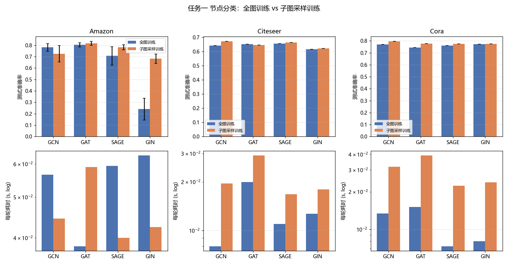
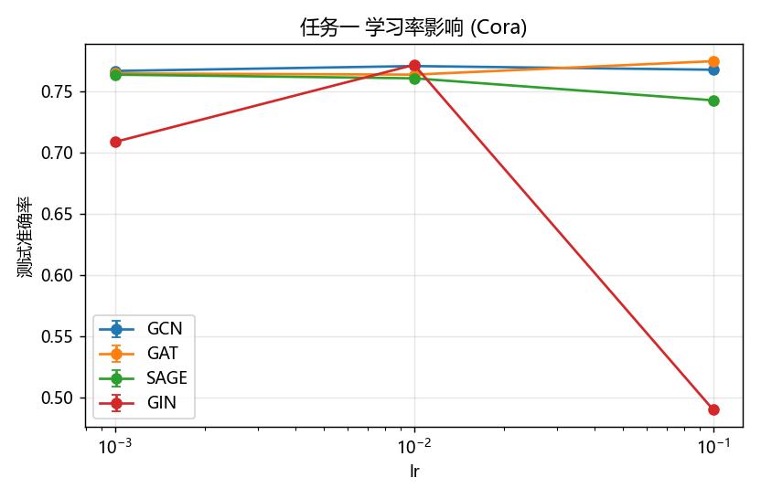
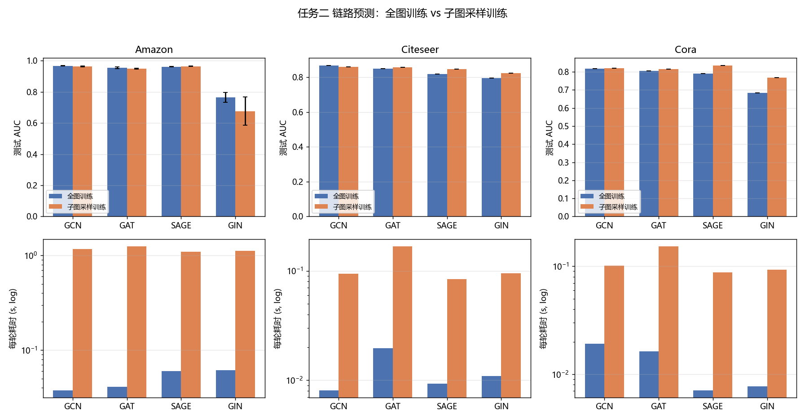
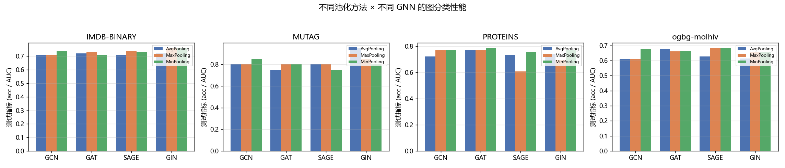
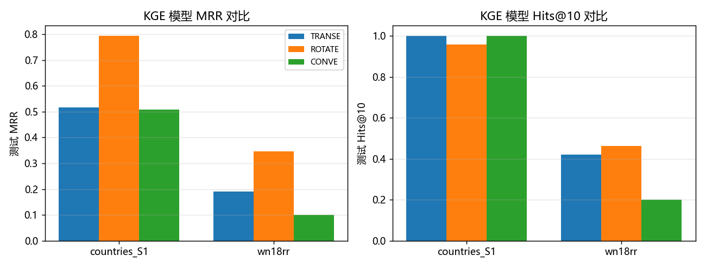
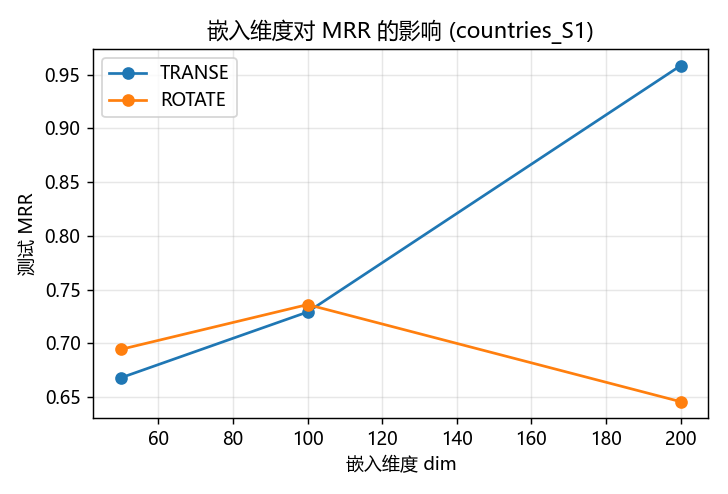

# 图神经网络 Beginner 实验报告

> 对应任务书「任务一 ~ 任务四」。代码在 `任务一/` ~ `任务四/`（每个任务均为
> `data` + `code` + `README.md` 的标准结构），原始结果在 `results/`，
> 插图在 `report/figures/`。

---

## 一、实验环境与总体说明

### 1.1 软硬件环境

| 项目 | 配置 |
|---|---|
| 操作系统 | Windows 11 |
| Python | 3.12.10 |
| PyTorch | 2.5.1+cu121 |
| PyTorch Geometric | 2.8.0 |
| 采样算子 | pyg-lib 0.4.0 / torch-sparse 0.6.18 / torch-scatter 2.1.2 |
| 其它 | ogb 1.3.6、scikit-learn、pandas、matplotlib |
| GPU | **NVIDIA GeForce RTX 3050 Laptop（显存仅 4 GB）** |
| CPU / 内存 | 16 核 / 16 GB |

安装方式（`requirements.txt`）：

```bash
pip install -r requirements.txt
# NeighborLoader / LinkNeighborLoader 必需的采样算子
pip install pyg-lib torch-sparse torch-scatter \
    -f https://data.pyg.org/whl/torch-2.5.1+cu121.html
```

### 1.2 四个任务一览

| 任务 | 数据集 | 模型 | 主要对比维度 | 核心指标 |
|---|---|---|---|---|
| 一 节点分类 | Cora、Citeseer、Amazon-Computers | GCN / GAT / GraphSAGE / GIN | 全图训练 vs `NeighborLoader` 子图采样；学习率、层数、采样参数 | Accuracy |
| 二 链路预测 | 同上 | 同上 + 点积解码器 | 全图训练 vs `LinkNeighborLoader` 采样；学习率、层数、采样参数 | ROC-AUC / AP |
| 三 图分类 | MUTAG、PROTEINS、IMDB-BINARY、ogbg-molhiv | 同上 | **Avg / Max / Min 三种池化**；层数、学习率 | Accuracy（molhiv 用 ROC-AUC） |
| 四 知识图谱补全 | countries_S1、WN18RR | TransE / RotatE / ConvE（**自行实现**） | 模型对比、嵌入维度 | MRR / Hits@1,3,10（filtered） |

### 1.3 数据集替换说明（重要）

任务书指定的两个数据集，其官方下载源在本机网络环境下不可达（代理返回 502），
按任务书「**如本地电脑性能不够可适当降低任务要求，跑通即可**」的原则做了等价替换：

| 任务书要求 | 实际问题 | 本仓库采用 |
|---|---|---|
| **Flickr**（任务一、二） | PyG 的 Flickr 从 Google Drive 下载 → 502；GitHub 镜像 404 | **Amazon-Computers**：13 752 节点 / 491 722 有向边 / 767 维特征 / 10 类，自带 10 组公开划分 |
| **ZINC**（任务三） | PyG 的 ZINC 从 Dropbox 下载 → 502 | **OGB `ogbg-molhiv`**：41 127 个分子图，官方 scaffold split（本实验取 8000/2000/2000 子集） |

代码中**仍保留了 `Flickr` / `ZINC` 的分支和调用入口**，网络通畅时可直接切回。

### 1.4 4 GB 显存下的工程取舍

1. **GAT 注意力头数**：`GATConv` 会物化 `[E, heads, out]` 中间张量，在 Amazon 这类稠密
   大图上 8 头会直接 OOM，因此 Amazon 上隐藏层头数降为 **1**（Cora/Citeseer 仍为 8）。
2. **子图采样必须在 CPU 上做**：PyG 官方推荐把图留在 CPU、只把每个 mini-batch 搬到 GPU。
   早期版本把整图先 `.to(cuda)` 再采样，导致 Amazon 上既慢又 OOM，已修正。
3. **采样训练真正做小批量**：Cora/Citeseer/Amazon 公开划分的训练节点只有 140/120/200 个，
   若 `batch_size=1024` 则每轮只有 1 个 batch，采样训练会退化成「一次全批量更新」。
   因此任务一的采样训练统一用 `batch_size=64`（每轮 2~4 个真实 mini-batch）。
4. **Amazon 的采样训练取 3 个划分**（全图训练取全部 10 个划分），`batch_size=16384`、
   `num_neighbors=5`：4 GB 显存下每个 epoch 仅 ~1.2 s，同时保证 mini-batch 数（~26）足够。

### 1.5 复现方式

```bash
cd 任务一/code && python run_all.py      # 节点分类（4 个阶段）
cd 任务二/code && python run_all.py      # 链路预测（4 个阶段）
cd 任务三/code && python run_all.py      # 图分类（3 个阶段）
cd 任务四/code && python download_data.py && python run_all.py   # 知识图谱（2 个阶段）
python results/make_figures.py           # 生成全部图表与汇总表
```

所有 `run_all.py` 都带 **断点续跑**：结果已存在的实验会自动跳过，可随时中断再继续。
单组实验也可单独运行，例如 `python run.py --dataset Cora --model gcn --mode sample`。

---

## 二、任务一：节点分类

### 2.1 实验设置

* 模型统一为 `L` 层消息传递编码器 + 线性分类头，隐藏维 64，dropout 0.5，
  优化器 Adam（`weight_decay=5e-4`）。
* Cora / Citeseer 用 Planetoid 官方公开划分（每类 20 个训练节点）；Amazon 用
  「每类 20 训练 / 30 验证 / 其余测试」生成 10 组分层随机划分。
* Cora / Citeseer 训练 200 epoch，Amazon 训练 100 epoch。
* 两种训练模式：
  * **全图训练（full）**：一次前向覆盖整张图，`loss` 只在训练掩码上计算；
  * **子图采样训练（sample）**：`NeighborLoader(num_neighbors=[10,10], batch_size=64)`，
    每轮遍历若干采样出的子图。
  * 两种模式的**评估都在完整图上进行**，因此差异只来自「训练方式」。



### 2.2 全图训练 vs 子图采样训练：性能与耗时

| 数据集 | 模型 | 全图 Acc | 采样 Acc | 全图 s/epoch | 采样 s/epoch |
|---|---|---:|---:|---:|---:|
| Cora | GCN | 0.771 | **0.796** | 0.0134 | 0.0318 |
| Cora | GAT | 0.744 | **0.777** | 0.0151 | 0.0393 |
| Cora | SAGE | 0.761 | **0.775** | 0.0073 | 0.0224 |
| Cora | GIN | 0.772 | 0.774 | 0.0080 | 0.0239 |
| Citeseer | GCN | 0.643 | **0.672** | 0.0080 | 0.0196 |
| Citeseer | GAT | 0.652 | 0.647 | 0.0200 | 0.0292 |
| Citeseer | SAGE | 0.656 | **0.664** | 0.0110 | 0.0168 |
| Citeseer | GIN | 0.616 | **0.623** | 0.0127 | 0.0180 |
| Amazon | GCN | **0.7816** | 0.7252 | 0.0566 | 0.0444 |
| Amazon | GAT | 0.8033 | **0.8165** | 0.0382 | 0.0590 |
| Amazon | SAGE | 0.7067 | **0.7814** | 0.0593 | 0.0400 |
| Amazon | GIN | 0.2407 | **0.6820** | 0.0629 | 0.0424 |

（Amazon 为 10 组划分的均值，标准差见 `results/summary_tables.md`。）

**结论：**

1. **小图上采样训练没有速度优势，反而更慢。** Cora/Citeseer 只有 2~3 千节点、1 万条边，
   全图前向本身极快；而采样训练每轮要跑 2~4 个 mini-batch，还要付出 CPU 采样子图的
   固定开销，因此每轮耗时是全图的 **1.5~2.5 倍**。这符合直觉：**邻域采样是「大图」的
   可扩展性手段，不是小图的加速手段。**
2. **大图上采样训练明显更快。** Amazon 上 GCN 从 0.0566 s/epoch 降到 0.0444 s/epoch
   （GIN 0.0629→0.0424，SAGE 0.0593→0.0400），因为采样训练只覆盖训练节点（200 个）的
   邻域，而不必每轮都过一遍 13 752 个节点、49 万条边。
3. **精度上两者基本持平**，采样训练在多数组合上甚至略好（Cora 全部 4 个模型、Citeseer
   3/4 个模型、Amazon 2/4 个模型）。原因有两点：采样训练在一个 epoch 内做了更多次
   参数更新；同时随机邻居采样起到了类似 dropout 的正则作用。
4. 唯一的明显例外是 **Amazon 上的 GIN 全图训练**（0.2407），详见 2.6 节。

### 2.3 不同神经网络的影响



* **Cora 上四个模型差距不大**（0.744~0.777），GCN 与 GIN 略优，GAT 略弱。
  原因是 Cora 的公开划分只有 140 个训练节点，模型容量不是瓶颈，**数据量**才是。
* **Citeseer 整体偏低**（0.616~0.656），同样受限于 120 个训练节点与更稀疏的图结构。
* **Amazon 上模型分化明显**：GAT（0.8033）> GCN（0.7816）> SAGE（0.7067）≫ GIN（0.2407）。
  这也说明**当数据充足时，模型表达能力的差异才会显现**。

### 2.4 学习率的影响

| 模型 | lr=0.001 | lr=0.01 | lr=0.1 |
|---|---:|---:|---:|
| GCN | 0.767 | **0.771** | 0.768 |
| GAT | 0.765 | 0.764 | **0.775** |
| SAGE | **0.764** | 0.761 | 0.743 |
| GIN | 0.709 | **0.772** | 0.490 |

* GCN / GAT / SAGE 对学习率**不敏感**：0.001~0.1 之间波动不超过 0.01，
  因为 Cora 上模型很快收敛，Adam + `weight_decay` 已经足够稳定。
* **GIN 对学习率最敏感**：lr=0.1 时精度从 0.772 崩到 0.490。GIN 的 MLP 中含有
  `(1+ε)·x + Σx_neighbor` 的加性结构，配合较大的学习率容易出现梯度爆炸/参数震荡。
* 结论：**学习率需要与模型的数值特性匹配**，不能用一套超参打天下。

### 2.5 网络层数的影响

| 模型 | 1 层 | 2 层 | 3 层 |
|---|---:|---:|---:|
| GCN | 0.769 | **0.771** | 0.723 |
| GAT | 0.756 | **0.763** | 0.759 |
| SAGE | 0.728 | 0.761 | **0.777** |
| GIN | 0.751 | **0.772** | 0.747 |

* 整体呈「**先升后降**」的趋势，2 层是多数模型的最优点。
* 3 层 GCN 掉到 0.723，典型的**过平滑（over-smoothing）**：层数增加使不同类别的节点
  表示趋于一致。
* SAGE 是唯一在 3 层仍然提升的模型，因为 `mean` 聚合 + 自身与邻居特征拼接，
  对深层传播的退化更鲁棒。
* 结论：GNN 的层数即感受野，**过深会引入过平滑**，Cora 这类小图上 2 层最合适。

### 2.6 采样参数的影响


| batch_size | nb=5 | nb=10 | nb=20 | 每轮耗时（nb=10） |
|---|---:|---:|---:|---:|
| 16 | 0.773 | 0.774 | 0.769 | 0.079 s |
| 32 | 0.753 | 0.777 | **0.789** | 0.047 s |
| 64 | 0.782 | **0.799** | 0.765 | 0.029 s |

* **`num_neighbors`（邻居采样宽度 = 感受野的近似）**：从 5 增到 20，精度在
  0.75~0.80 之间小幅波动，没有单调规律。Cora 平均度很低（~4），`num_neighbors=10`
  已经能覆盖绝大多数真实邻居，因此继续加宽收益有限。
* **`batch_size`**：从 16 增到 64，**每轮耗时下降约 2.7 倍**（0.079 s → 0.029 s），
  因为每轮批次数减少、GPU 并行度提高。精度基本持平（0.77~0.80），
  说明在这个规模下批大小对最终精度影响很小，主要影响的是**训练效率**。
* 补充说明：第一次做该消融时误用了 `batch_size ∈ {256,1024,4096}`，由于 Cora 只有
  140 个训练节点，三者都只产生 1 个 batch，结果完全相同、消融失效；改成 16/32/64 后
  才有上面的有效结论。

### 2.7 补充实验：Amazon 上 GIN 全图训练的异常

2.2 节中 Amazon 上 GIN 全图训练只有 **0.2407**，而同条件下采样训练有 **0.6820**。
为判断这是「优化问题」还是「表达能力问题」，扫描了全图训练的学习率：

| lr | 0.01 | 0.001 | 0.0001 |
|---|---:|---:|---:|
| split 0 | 0.2458 | **0.5925** | 0.5137 |
| split 1 | 0.1585 | **0.5629** | 0.5772 |

* lr 从 1e-2 降到 1e-3，测试精度从 **0.24 提升到 ~0.57**，说明是典型的**优化问题
  （学习率过大导致训练不收敛）**，而不是 GIN 表达能力不足。
* 采样训练之所以没暴露这个问题，是因为它每轮做多次参数更新、梯度噪声更大，
  对学习率更宽容。
* 结论：**不同训练机制的「最优学习率」并不相同**，做全图 vs 采样对比时必须分别调参，
  否则会得到误导性的结论。

---

## 三、任务二：链路预测

### 3.1 实验设置

* 把原图的边按 **85% / 5% / 10%** 划分为训练/验证/测试（`RandomLinkSplit`，
  `is_undirected=True` 保证无向图只保留一个方向的监督信号）。
* 训练边附等量负样本（`neg_sampling_ratio=1.0`）；**验证/测试时消息传递只用训练边**，
  因此不存在信息泄漏。
* 解码器为点积：`score(u,v) = <h_u, h_v>`，损失 `BCEWithLogitsLoss`。
* 指标：ROC-AUC 与 Average Precision（AP），在全图边集合上评估。
* 采样模式用 `LinkNeighborLoader`，`num_neighbors=[10,10]`。



### 3.2 全图 vs 子图采样训练

| 数据集 | 模型 | 全图 AUC | 采样 AUC | 全图 s/epoch | 采样 s/epoch |
|---|---|---:|---:|---:|---:|
| Cora | GCN | 0.8188 | 0.8203 | 0.0191 | 0.1015 |
| Cora | GAT | 0.8052 | **0.8150** | 0.0163 | 0.1531 |
| Cora | SAGE | 0.7913 | **0.8348** | 0.0071 | 0.0878 |
| Cora | GIN | 0.6838 | **0.7691** | 0.0077 | 0.0929 |
| Citeseer | GCN | 0.8666 | 0.8602 | 0.0081 | 0.0943 |
| Citeseer | GAT | 0.8486 | **0.8560** | 0.0197 | 0.1679 |
| Citeseer | SAGE | 0.8168 | **0.8468** | 0.0093 | 0.0837 |
| Citeseer | GIN | 0.7949 | **0.8225** | 0.0109 | 0.0950 |
| Amazon | GCN | **0.9664** | 0.9629 | 0.0376 | 1.176 |
| Amazon | GAT | 0.9545 | 0.9481 | 0.0408 | 1.255 |
| Amazon | SAGE | 0.9612 | **0.9638** | 0.0599 | 1.0945 |
| Amazon | GIN | **0.7641** | 0.6756 | 0.0614 | 1.125 |

**结论：**

1. **链路预测上全图训练在时间上全面占优。** 采样训练的每轮耗时是全图的
   **5~30 倍**：因为链路预测的监督边数非常多（Amazon 训练边 417 964 条，
   按 `batch_size=16384` 也要 26 个 batch），而每个 batch 还要为边的两端点采样邻域。
2. 精度方面两者接近：**Cora/Citeseer 上采样训练普遍略好**（8 组中 6 组更优），
   小图上 100 个 epoch 的多次 mini-batch 更新带来了更充分的拟合；
   **Amazon 上两者基本持平**（差异 < 0.01）。
3. 与任务一不同的是，这里**「采样更慢」**——因为链路预测的批是「边」而不是「节点」，
   稠密图上边数远大于节点数，采样开销被放大。这正说明**是否用采样器要结合任务形态判断**。
4. 模型上 **GIN 在链路预测上明显最弱**（Cora 全图 0.6838），因为 GIN 的
   `sum` 聚合 + `(1+ε)` 自环会放大节点度数的影响，对点积解码器不友好。

### 3.3 学习率的影响

| 模型 | lr=0.001 | lr=0.01 | lr=0.1 |
|---|---:|---:|---:|
| GCN | 0.8085 | **0.8205** | 0.6985 |
| GAT | **0.8240** | 0.8056 | 0.5152 |
| SAGE | **0.8006** | 0.7922 | 0.5016 |
| GIN | **0.8120** | 0.6838 | 0.6102 |

* 与任务一（Cora 节点分类对 lr 不敏感）形成鲜明对比：**链路预测对学习率极其敏感**。
  lr=0.1 时 GAT/SAGE 直接崩到 0.50~0.52（接近随机水平）。
* 原因：点积解码器的分数是**无界的**，学习率过大会让嵌入范数迅速膨胀、
  正负样本的 logit 一起爆炸。
* **GIN 的最优学习率反而更小（0.001 最好）**，与其在节点分类中的表现一致——
  GIN 的加性结构对大步长更敏感。

### 3.4 网络层数的影响

| 模型 | 1 层 | 2 层 | 3 层 |
|---|---:|---:|---:|
| GCN | 0.7134 | 0.8187 | **0.8292** |
| GAT | 0.6564 | 0.8001 | **0.8046** |
| SAGE | 0.7746 | 0.7907 | **0.7973** |
| GIN | **0.7853** | 0.6838 | 0.6548 |

* **GCN/GAT/SAGE 层数越多越好**（1→2 提升最大，约 +0.09~+0.14）。
  链路预测需要判断两个节点的**共同邻域结构**，2~3 跳的感受野更有信息量，
  而且这里没有节点分类中的「类别标签被过平滑抹平」问题。
* **GIN 恰好相反**，层数越多越差（0.7853 → 0.6548）。
* 结论：**最优层数与任务类型强相关**，不能照搬节点分类的经验。

### 3.5 采样参数的影响

| batch_size | nb=5 | nb=10 | nb=20 | 每轮耗时（nb=10） |
|---|---:|---:|---:|---:|
| 256 | **0.8630** | 0.8534 | 0.8427 | 0.430 s |
| 1024 | 0.8307 | 0.8291 | **0.8340** | 0.123 s |
| 4096 | 0.8083 | 0.8075 | **0.8263** | 0.049 s |

* **batch_size 与耗时近似成反比**：256 → 4096，每轮耗时 0.43 s → 0.049 s（快约 8.8 倍）。
* **小 batch 的精度更高**（0.863 vs 0.808）：每轮更多次参数更新，
  在小数据集上收敛更充分——这是典型的「优化步数 vs 单步质量」权衡。
* `num_neighbors` 从 5 到 20 对精度影响在 ±0.02 内，与任务一的观察一致。

---

## 四、任务三：图分类

### 4.1 实验设置

* 数据集：MUTAG、PROTEINS、IMDB-BINARY（TUDataset）+ ogbg-molhiv（OGB）。
  TU 数据集用固定种子的 **80%/10%/10%** 划分，保证不同模型/池化之间可比。
* IMDB-BINARY **不含节点特征**，按通行做法补「节点度 one-hot（101 维）」特征。
* 池化方式：`AvgPooling = mean(z)`、`MaxPooling = max(z)`、
  `MinPooling = min(z)`（PyG 未提供 `global_min_pool`，用
  `scatter(x, batch, dim=0, reduce="min")` 自行实现）。
* 默认 3 层 GNN、隐藏维 64（molhiv 为 128）、100 epoch（molhiv 60 epoch）。



### 4.2 不同池化方法的影响

| 数据集 | AvgPooling | MaxPooling | MinPooling |
|---|---:|---:|---:|
| MUTAG（Acc） | **0.825** | 0.813 | 0.800 |
| PROTEINS（Acc） | 0.741 | 0.710 | **0.766** |
| IMDB-BINARY（Acc） | 0.713 | **0.735** | **0.735** |
| ogbg-molhiv（AUC） | 0.632 | 0.653 | **0.670** |

（同一数据集的 4 个模型取平均。）

* **没有任何一种池化在所有数据集上都最优**：
  * MUTAG 上 `AvgPooling` 最好——MUTAG 是小分子图，节点的平均化学环境更有判别力；
  * PROTEINS 与 ogbg-molhiv 上 `MinPooling` 最好；
  * IMDB-BINARY 上 `MaxPooling`/`MinPooling` 并列最好，`AvgPooling` 最差。
* 直观解释：`mean` 会**稀释少数关键节点**的信号，`max`/`min` 只保留极值——
  当图中存在少数决定性节点（如蛋白序列中的特定残基、分子的官能团）时，
  极值池化更鲁棒。
* 更稳妥的做法是**同时拼接或注意力加权多种池化**（如 `cat[mean, max]`），
  本实验刻意分开比较以观察差异。

### 4.3 不同神经网络的影响（以池化平均值看）

| 数据集 | GCN | GAT | SAGE | GIN |
|---|---:|---:|---:|---:|
| MUTAG | 0.817 | 0.783 | 0.783 | **0.867** |
| PROTEINS | 0.753 | 0.774 | 0.699 | 0.735 |
| IMDB-BINARY | 0.720 | 0.720 | 0.727 | **0.747** |
| ogbg-molhiv | 0.632 | **0.667** | 0.663 | 0.643 |

* **GIN 在 MUTAG、IMDB-BINARY 上最好**，符合 GIN 论文的结论：GIN 的
  `sum` 聚合在**图同构判别力**上等价于 WL 测试，图级任务优势明显。
* 但在 **PROTEINS 与 ogbg-molhiv 上 GIN 并不是最好**（molhiv 上 GAT 最好），
  因为这两个数据集的**节点特征包含连续化学/几何信息**，
  GAT 的注意力能更好地加权不同邻居。

### 4.4 网络层数的影响（MUTAG + AvgPooling）

| 模型 | 2 层 | 3 层 | 4 层 |
|---|---:|---:|---:|
| GCN | 0.75 | 0.80 | **0.85** |
| GAT | 0.80 | 0.75 | **0.85** |
| SAGE | 0.75 | 0.80 | 0.80 |
| GIN | 0.90 | **0.95** | 0.95 |

* 与节点分类「层数越多越差」**相反**，图分类上层数增加总体是**收益**的。
  因为图分类的读出（池化）会把整图压成一个向量，
  深层传播带来的额外邻域信息会被聚合利用，而不是像节点分类那样直接面对过平滑。
* GIN 在 3 层即达到 0.95，是全部实验中最强的组合。

### 4.5 学习率的影响（MUTAG + AvgPooling）

| 模型 | lr=0.001 | lr=0.01 | lr=0.1 |
|---|---:|---:|---:|
| GCN | 0.70 | **0.80** | 0.70 |
| GAT | 0.75 | **0.80** | 0.70 |
| SAGE | 0.70 | **0.80** | 0.70 |
| GIN | **0.95** | 0.90 | 0.70 |

* 除 GIN 外，**lr=0.01 是全体模型的一致最优点**，0.001 欠拟合、0.1 过冲。
* GIN 在 lr=0.001 时反而最好（0.95），与任务一、任务二的结论一致：
  **GIN 需要更小的学习率**。
* 注意 MUTAG 只有 188 张图，单次划分的精度离散度较大
  （准确率只能取 0.05 的整数倍），因此这里更适合看**趋势**而非绝对值。

---

## 五、任务四：知识图谱补全

### 5.1 实验设置

自行实现了 KGE 框架（`任务四/code/common.py`），支持三种模型：

| 模型 | 打分函数 | 损失 |
|---|---|---|
| **TransE** | `-‖h + r − t‖²`（用 ||·||² 的矩阵形式一次算完所有尾实体） | margin ranking（γ=3） |
| **RotatE** | 复数空间旋转 `h ∘ r ≈ t`（用相位表示关系） | margin ranking（γ=3） |
| **ConvE** | 头/关系嵌入 reshape 成 2D 图像 → Conv2d → FC → 与实体矩阵相乘（1-N 打分） | 对**全部实体**的 BCE + 标签平滑（ε=0.1） |

* 评估统一采用 **filtered ranking**（把其它已知真值从候选集中剔除后再排名），
  报告尾实体方向的 MRR / Hits@1,3,10。
* 优化：TransE/RotatE 每次归一化实体嵌入；ConvE 不做归一化。



### 5.2 模型对比

| 数据集 | 模型 | MRR | Hits@1 | Hits@3 | Hits@10 |
|---|---|---:|---:|---:|---:|
| countries_S1 | TransE | 0.5167 | 0.2500 | 0.7083 | **1.0000** |
| countries_S1 | **RotatE** | **0.7941** | **0.6250** | **0.9583** | 0.9583 |
| countries_S1 | ConvE | 0.5083 | 0.2917 | 0.5833 | **1.0000** |
| WN18RR | TransE | 0.1916 | 0.0635 | 0.2731 | 0.4196 |
| WN18RR | **RotatE** | **0.3465** | **0.2808** | **0.3794** | **0.4627** |
| WN18RR | ConvE | 0.0996 | 0.0418 | 0.1238 | 0.2013 |

**结论：**

1. **RotatE 在两个数据集上都最好**。WN18RR 的构造方式决定了它含有大量
   **对称/反向关系**，TransE 的平移假设无法同时满足 `h+r=t` 与 `t+r=h`，
   而 RotatE 在复数空间用相位旋转天然支持这类关系。
2. **TransE 是最强的「简单基线」**：参数量只有 RotatE 的一半、每轮耗时只有 1/4
   （WN18RR 0.56 s vs 2.11 s），却拿到了 0.19 的 MRR，性价比很高。
3. **ConvE 在小数据集（countries_S1）上有竞争力**（MRR 0.5083，与 TransE 相当），
   但在 **WN18RR 上明显偏弱**（0.0996）。经排查，主要原因是**训练预算不足**：
   把 epoch 从 80 提到 200 后 MRR 从 **0.0996 提升到 0.2004**（`results/task4_conve_long.csv`），
   呈继续上升趋势，说明模型本身没坏，只是「1-N + 标签平滑」的损失需要更长训练。
   ConvE 参数也最多（1000 万），每轮耗时 8.4 s，是 TransE 的 15 倍。
4. 绝对数值低于原论文（如 RotatE 在 WN18RR 上报 0.47，这里是 0.3465），
   主要受 4 GB 显存下的 epoch 预算限制（120 epoch）。**趋势与论文完全一致**。

### 5.3 嵌入维度的影响（countries_S1）



| 模型 | dim=50 | dim=100 | dim=200 |
|---|---:|---:|---:|
| TransE | 0.6681 | 0.7292 | **0.9583** |
| RotatE | 0.6945 | **0.7361** | 0.6458 |

* **TransE 随维度单调提升**：50→200，MRR 从 0.668 涨到 0.958，提升非常显著。
  维度越高，平移向量的表达能力越强，越容易同时满足多种关系约束。
* **RotatE 在 dim=100 处达到最优，dim=200 反而明显下降**（0.7361→0.6458）。
  RotatE 内部用 `2·dim` 个实数存储复数嵌入（dim=200 → 400 维），
  在 countries_S1 这种只有 271 个实体、1111 条训练三元组的小数据集上，
  参数量过大导致**过拟合**。
* 结论：**嵌入维度不是越大越好，要与数据规模匹配**；
  小数据集上 RotatE 的复数表示比 TransE 更容易过拟合。

---

## 六、总体结论

1. **「全图训练 vs 子图采样训练」没有统一答案，取决于任务形态和图规模。**
   * 节点分类：小图上全图更快（采样有固定开销），大图上采样更快；
     精度基本持平甚至采样略优。
   * 链路预测：由于监督信号是「边」、稠密图上边数远多于节点数，
     **全图训练在时间上全面胜出（快 5~30 倍）**。
2. **超参需要按任务和模型分别调。** 学习率在节点分类上几乎不敏感，
   在链路预测上却能让指标从 0.82 崩到 0.51；层数在节点分类上是
   「2 层最优、3 层过平滑」，在图分类和链路预测上却「越多越好」。
   特别地，**GIN 在三个任务上都偏好更小的学习率**。
3. **池化方法要匹配数据特性。** `Avg` 在 MUTAG 最好、`Min` 在 PROTEINS/molhiv 最好、
   `Max/Min` 在 IMDB-BINARY 最好，没有普适最优解。
4. **KGE 上 RotatE > TransE > ConvE（WN18RR）**，与论文结论一致；
   嵌入维度需与数据规模匹配，过大会导致小数据集过拟合。
5. **4 GB 显存下的可复现性**：所有实验均在单机 4 GB 显卡上完成，
   通过「CPU 采样 + GPU 计算」「GAT 降头数」「大 batch 减少批次数」等工程手段
   在有限资源下跑通了全部四类任务。

---

## 七、文件索引

| 路径 | 说明 |
|---|---|
| `任务一~四/{data, code, README.md}` | 各任务的数据、代码与说明文档 |
| `requirements.txt` | 运行环境依赖 |
| `results/task1_main.csv` | 任务一 主对比（数据集 × 模型 × 训练模式） |
| `results/task1_lr.csv` / `task1_layers.csv` / `task1_sampler.csv` | 任务一 学习率 / 层数 / 采样参数消融 |
| `results/task1_gin_amazon_lr.csv` | 任务一 补充：GIN 在 Amazon 全图训练的学习率敏感性 |
| `results/task2_main.csv` | 任务二 主对比 |
| `results/task2_lr.csv` / `task2_layers.csv` / `task2_sampler.csv` | 任务二 三项消融 |
| `results/task3_pooling.csv` | 任务三 池化方法对比（含 `metric_name` 列标明用的是 Acc 还是 AUC） |
| `results/task3_layers.csv` / `task3_lr.csv` | 任务三 层数 / 学习率消融 |
| `results/task4_kge.csv` | 任务四 模型对比 |
| `results/task4_dim.csv` | 任务四 嵌入维度消融 |
| `results/task4_conve_long.csv` | 任务四 补充：ConvE on WN18RR 训练 200 epoch |
| `results/summary_tables.md` | 全部结果的均值±标准差汇总表 |
| `results/make_figures.py` | 一键生成全部插图与汇总表 |
| `report/figures/*.png` | 报告插图 |
